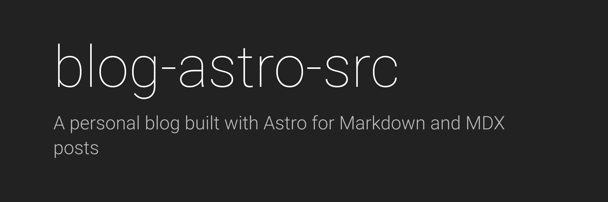
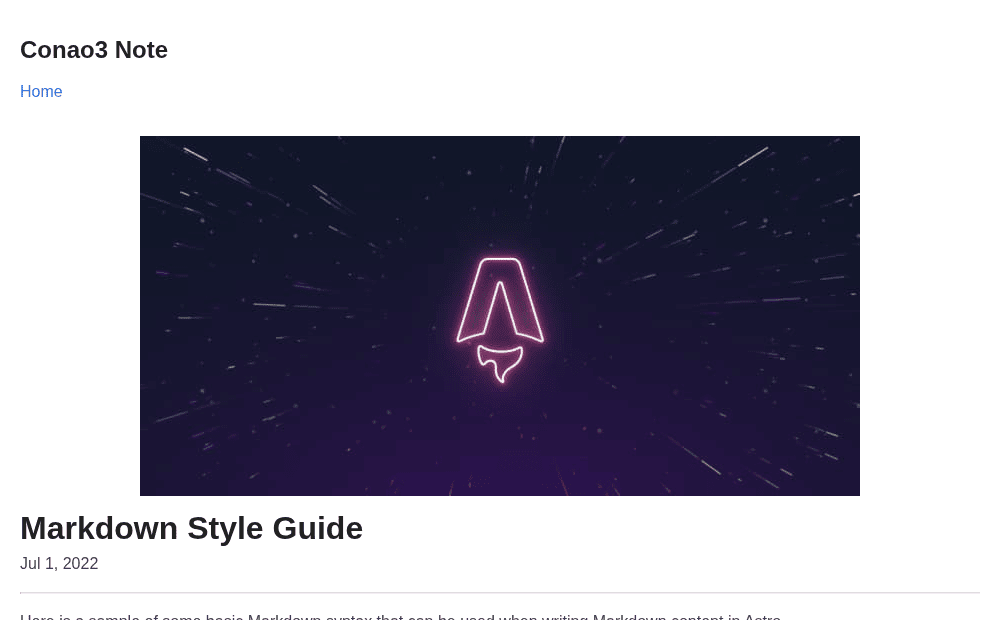
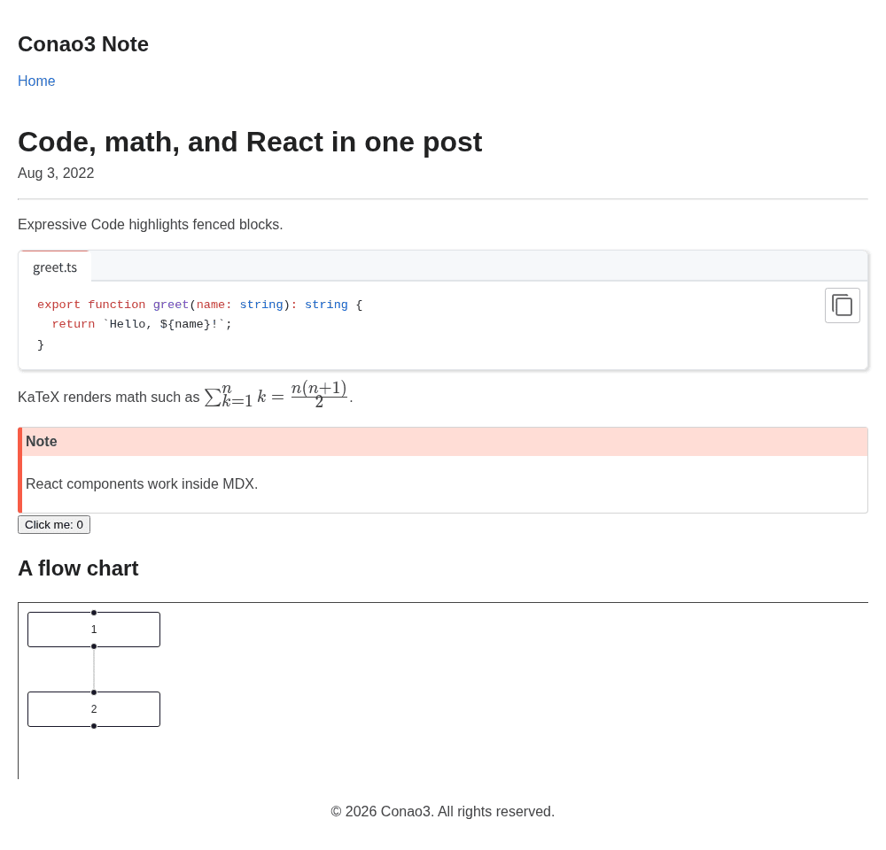
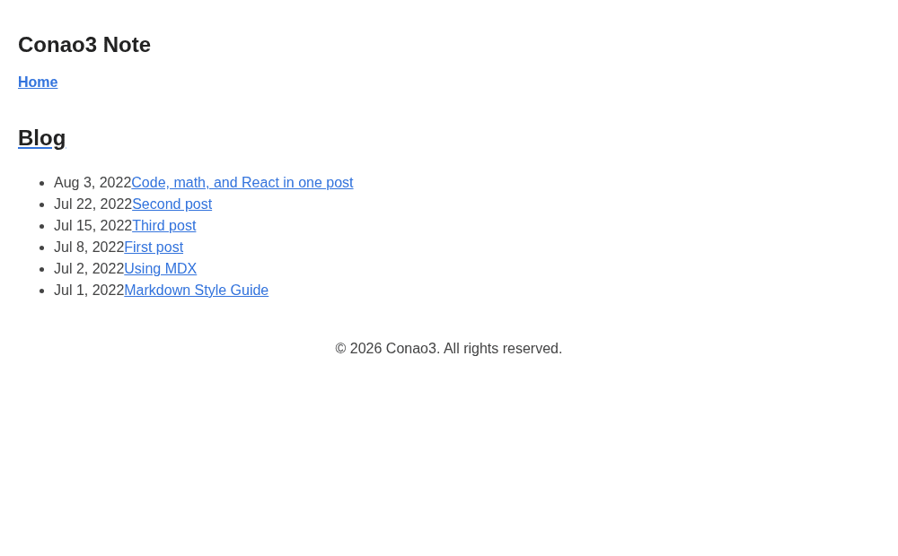

<p align="center"></p>

<p align="center"><strong>A personal blog built with Astro for Markdown and MDX posts</strong></p>

<p align="center"><a href="https://github.com/conao3/blog-astro-src/stargazers"></a></p>

<p align="center"><a href="#features">Features</a> | <a href="#getting-started">Getting Started</a> | <a href="#learn-more">Learn More</a> | <a href="#credit">Credit</a></p>

<h1>blog-astro-src</h1>

A personal blog built with [Astro](https://astro.build), based on the official Astro Blog template.

## Features





Screenshots show a local build filled with sample posts.

- Minimal, clean styling
- Excellent Lighthouse performance scores
- SEO-friendly with canonical URLs and OpenGraph data
- Sitemap and RSS Feed support
- Markdown and MDX support

## Project Structure

```
├── public/
├── src/
│   ├── components/
│   ├── content/
│   ├── layouts/
│   └── pages/
├── astro.config.mjs
├── package.json
└── tsconfig.json
```

- `src/pages/` - Astro and Markdown files that become routes based on their file names
- `src/components/` - Reusable Astro, React, Vue, Svelte, or Preact components
- `src/content/` - Content collections for blog posts and other documents
- `public/` - Static assets like images

## Getting Started

All commands are run from the project root:

| Command                | Action                                           |
| :--------------------- | :----------------------------------------------- |
| `npm install`          | Install dependencies                             |
| `npm run dev`          | Start local dev server at `localhost:3000`       |
| `npm run build`        | Build production site to `./dist/`               |
| `npm run preview`      | Preview build locally before deploying           |
| `npm run astro ...`    | Run CLI commands like `astro add`, `astro check` |



Screenshots show a local build filled with sample posts.

## Learn More

- [Astro Documentation](https://docs.astro.build)
- [Astro Discord Community](https://astro.build/chat)
- [Content Collections Guide](https://docs.astro.build/en/guides/content-collections/)

## Credit

This theme is based on [Bear Blog](https://github.com/HermanMartinus/bearblog/).
